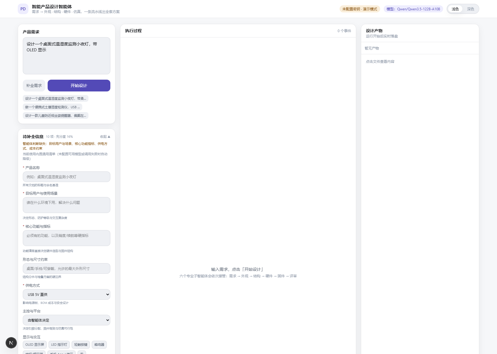
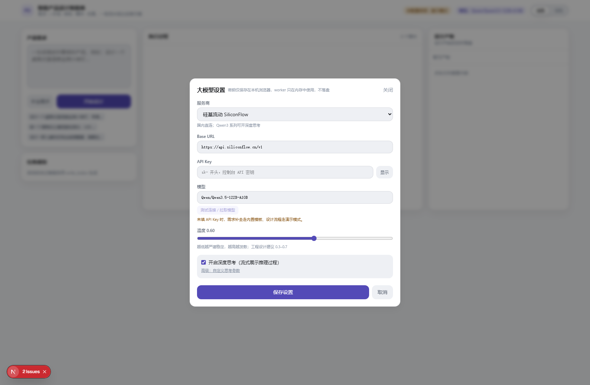
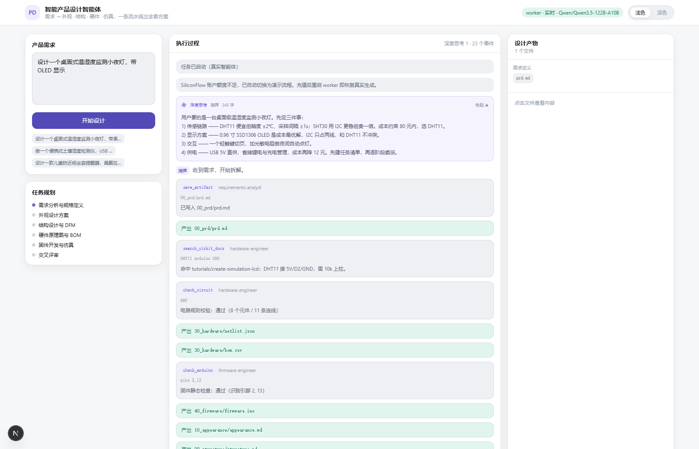

# 智能产品设计智能体

输入一句产品需求 → 智能体自主规划 → 并行产出 **外观 / 结构 / 硬件 / 软件仿真** 四套方案 → 评审 → 产物落盘。

| 层 | 技术 |
|---|---|
| 智能体内核 | `deepagents` 0.7（LangGraph 运行时）+ OpenAI 兼容网关 |
| 默认模型 | `agnes-2.5-flash`（原生流式 `reasoning_content`，工具调用稳定） |
| 结构 CAD | [`earthtojake/text-to-cad`](https://github.com/earthtojake/text-to-cad) 的建模规范 + `build123d` / OCP 内核 → STEP / STL / 3D 预览 |
| 图像生成 | Agnes `agnes-image-2.5-flash`（前端可切换 2.0/2.1 或换图床）→ 产品渲染图、爆炸图 |
| Worker | FastAPI + SSE，端口 `8001` |
| 前端 | Next.js 15 App Router + Tailwind v4，端口 `3000` |
| 知识库 | Cirkit Designer 文档全站 23 页 → 本地 BM25 检索（零依赖） |

> 模型实测：`agnes-2.5-flash` 流式下逐块吐 `reasoning_content` 且支持 function calling（默认）；
> `Qwen/Qwen3.5-*` 在硅基流动上需显式 `enable_thinking`；
> `deepseek-ai/DeepSeek-V3.2` 在硅基流动上**不下发** `reasoning_content`，不作默认思考模型。
> 换模型只需改 `.env` 的 `AGENT_MODEL` / `AGENT_BASE_URL`，或直接用前端「模型设置」面板。

## 本地启动

```bash
# 0) 取代码（vendor/text-to-cad 是子模块，需 --recursive 才会带上建模规范）
git clone --recursive git@github.com:lhbzx1984/smarthardware_agent.git
# 已 clone 过但 vendor 为空时：git submodule update --init

# 1) 配置密钥
cp .env.example .env        # 至少填一个：AGNES_API_KEY（文本+图像）或 SILICONFLOW_API_KEY

# 2) 安装 CAD 内核（结构设计要出 STEP/STL；几百 MB，不是源码编译，装前可先
#    pip install --dry-run --only-binary :all: build123d 验证有没有 wheel）
python -m pip install build123d

# 3) 一键启动（Windows / PowerShell）
.\start.ps1          # 拉起 worker :8001 + 前端 :3000，就绪后打印状态
.\stop.ps1           # 停掉两个服务

# 或手动启（两个终端）
cd agent && python server.py
cd web && npm install && npm run dev
```

打开 http://127.0.0.1:3000 。服务端 `.env` 里配了 key 时**开箱即用**（前端设置面板留空即可，
worker 会按网关地址自动取对应的那把 key）；一把 key 都没有时自动进入**演示模式**，UI 与事件流依然完整。

> 密钥优先级：**前端「模型设置」里填的** → `.env`（按 base_url 匹配 `AGNES_API_KEY` / `SILICONFLOW_API_KEY`）→ 演示模式。
> 前端填的密钥只存在浏览器 localStorage，随请求发给 worker，worker 仅在内存使用，不落盘、不写日志。

## 使用流程

```
一句话需求 ──►【补全需求】智能体列出缺失维度与待确认清单 ──► 用户填表 ──►
组装成《产品需求简报》 ──►【开始设计】六阶段流水线 ──► 产物落盘 + 交付汇总
```

**1. 需求补全（可选但强烈建议）**

点「补全需求」，智能体判断这句话离能开工还差什么，返回一份待确认清单（6–10 项），
带充分度评分、缺失维度、以及"为什么问这个"。表单支持文本 / 多行 / 下拉 / 多选，必填项不填会提示（可跳过，由智能体按默认假设推进）。填完点「用补全信息开始设计」，答案会拼成结构化简报给智能体。



清单由模型生成；模型不可用（没填密钥 / 额度不足 / 调用失败）时**自动降级为内置通用模板**（10 项，覆盖用户场景、功能指标、形态尺寸、供电、主控、显示交互、风格材质、成本、交付深度），流程永不断。

**2. 大模型设置**

右上角「模型：xxx」按钮打开设置面板：



| 项 | 说明 |
|---|---|
| 服务商 | 硅基流动 / DeepSeek / 智谱 / 阿里百炼 / Moonshot / OpenAI / 自定义（Ollama、vLLM 等任意 OpenAI 兼容网关） |
| Base URL | 选服务商自动填，可手改 |
| API Key | 必填；不填则整体降级为演示模式 |
| 模型 | 可手输，也可点「测试连接 / 拉取模型」用你的 key 拉回真实可用列表 |
| 温度 | 默认 0.6；工程设计建议 0.3–0.7 |
| 深度思考 | 开关 + 高级参数；留空时按模型名自动推断（Qwen3 → `enable_thinking`，GLM-4 → `thinking.type`，DeepSeek-R1 无需参数） |

设置存 `localStorage`，每次运行随请求下发；`/api/models` 同时充当**连通性自检**，错误 key 会明确回 `401 Token is invalid`。

## 目录

```
agent/          Python 智能体 worker
  config.py       配置与环境变量（默认 provider / 按网关匹配 .env 密钥）
  providers.py    服务商预设（8 家）+ 思考参数推断，只存公开元信息
  llm.py          ReasoningChatOpenAI：把流式 delta 里的 reasoning_content 捞回来
  clarify.py      需求补全清单生成 + 内置兜底模板 + 简报组装
  knowledge.py    BM25 知识库检索（Cirkit 文档）
  cad.py          结构 CAD：跑 build123d 脚本 → STEP/STL + 等轴测预览 SVG
  imagegen.py     Agnes 图像生成（产品渲染图 / 爆炸图）
  tools.py        7 个工具：search_cirkit_docs / save_artifact / check_circuit / build_bom /
                  check_arduino / build_structure / generate_product_image
  subagents.py    6 个专业子智能体（结构工程师会真跑 CAD，工业设计师会真出图）
  main_agent.py   create_deep_agent 装配 + 事件归一化（CID 精确配对工具 start/end）
  server.py       FastAPI + SSE（/api/providers /api/models /api/clarify，不可用时降级演示）
web/            Next.js 前端（通过 /api/agent/* 代理 worker，浏览器不直连 8001）
  lib/feed.ts        事件流 → 渲染模型的纯函数（增量聚合 + 工具 cid 配对，可单测）
  lib/settings.ts    模型设置的本地存储与请求载荷转换
  components/PcbBackdrop.tsx     PCB 电路背景（纯 SVG + CSS 走线流动动画）
  components/MiniMarkdown.tsx    轻量 Markdown 渲染（表格 / 图片 / 引用 / 代码块）
  components/SettingsDialog.tsx  大模型设置面板
  components/ClarifyForm.tsx     需求补全表单
  components/ThinkingBlock.tsx   深度思考块
vendor/text-to-cad/   text-to-cad 官方仓库（12 个 CAD skill，作为结构设计工作流规范；git 子模块）
knowledge/raw/  抓取的 Cirkit Designer 文档（23 页）
scripts/        crawl_docs.py（抓文档）、smoke.py（端到端冒烟）、test_feed.ts（聚合单测）
docs/           效果截图
AGENTS.md       智能体长期记忆与输出契约
workspace/<run_id>/  每次运行的产物
```

## 深度思考（reasoning）

智能体的思维链会以独立事件类型 `thinking` 实时推给前端，渲染成可折叠的「深度思考」区块：



实现要点（每一处都是踩过的坑）：

1. **langchain 会吞掉思维链**：`langchain-openai` 的 `_convert_delta_to_message_chunk` 只认 `content` / `tool_calls`，
   流式 delta 里的 `reasoning_content` 被直接丢弃 → `agent/llm.py` 子类化 `ChatOpenAI` 覆写 chunk 转换补写回 `additional_kwargs`。
2. **模型要选对**：不是所有 OpenAI 兼容模型都吐思维链，且开关参数名不统一（`enable_thinking` / `thinking_budget`），
   `agent/config.py` 用 `AGENT_THINKING_BODY` 暴露成 JSON 配置。
3. **前端不能一字一卡**：SSE 是逐 token 推送，必须按 `agent` 聚合连续增量再渲染（`web/lib/feed.ts`），
   否则就会出现「指令 我将 / 指令 为您 / 指令 设计 …」这种碎片墙。

| 环境变量 | 说明 |
|---|---|
| `AGENT_THINKING` | `1` 开 / `0` 关，默认 `1` |
| `AGENT_THINKING_BODY` | 思考开关的请求体参数，JSON，如 `{"enable_thinking": true}` |

## 智能体编排

主智能体持有 `write_todos` 任务清单，按序委派：

| 子智能体 | 产物 |
|---|---|
| requirements-analyst | `00_prd/prd.md` |
| industrial-designer | `10_appearance/appearance.md`、`orthographic.svg`、`render-prompts.md`、**`render-01.png`（真实渲染图）** |
| mechanical-engineer | `20_structure/structure.md`、**`model.py`、`model_*.step`、`model_*.stl`、`model_preview.svg`、`exploded-01.png`** |
| hardware-engineer | `30_hardware/hardware.md`、`netlist.json`、`bom.csv`、`cirkit-steps.md` |
| firmware-engineer | `40_firmware/firmware.ino`、`simulation.md` |
| integration-reviewer | `90_review/review.md` |

硬件方案强制过 `check_circuit`（缺限流电阻、电源短路判 P0），固件强制过 `check_arduino`。

## 结构设计：真实 CAD（不是画个示意图）

结构子智能体写一段 build123d 脚本，`build_structure` 工具在**子进程**里跑它，导出真几何：

```python
from build123d import *
W, D, H = 100.0, 80.0, 40.0            # 单位 mm，XY 平面 + Z 向上
WALL, R, BASE_H = 2.0, 8.0, 30.0

with BuildPart() as shell:
    Box(W, D, BASE_H, align=(Align.CENTER, Align.CENTER, Align.MIN))
    fillet(shell.edges().filter_by(Axis.Z), radius=R)
    with Locations((0, 0, WALL)):      # 掏内腔：显式减去内缩实体
        Box(W-2*WALL, D-2*WALL, BASE_H-WALL,
            align=(Align.CENTER, Align.CENTER, Align.MIN), mode=Mode.SUBTRACT)
    with Locations((0, 12, BASE_H-WALL/2)):      # 开窗 / 开口同法
        Box(34, 18, WALL, mode=Mode.SUBTRACT)

parts = {"下壳": shell.part, "上盖": lid.part.moved(Location((0, 0, BASE_H)))}
```

产出：每个零件一份 `.step`（可导入任何 CAD 软件）+ `.stl`（可切片打印），外加一张等轴测预览 SVG。
工具还会回传每个零件的**包围盒尺寸（mm）与体积（cm³）**，模型必须用这些真实数值写尺寸表 —— 不允许编数。

> build123d 0.13 有四个高频坑，模型一写就崩，现已写进工具 docstring、子智能体提示词和报错回传里：
> `Box(...).fillet(radius=2)`（fillet 要边列表）、`Workplanes(...)`（已移除）、
> `Cylinder(r=5, h=3)`（要 `radius=`/`height=`）、`offset(amount=-WALL)`（只内缩、不掏空）。
> 脚本失败时 `cad.hint_for()` 会按 traceback 特征回一条针对性修正建议，重试命中率明显更高。

运行时按优先级自动探测，任一可用即可：

| 运行时 | 来源 | 说明 |
|---|---|---|
| `local` | 当前 venv 的 `build123d` | 最快，`pip install build123d` |
| `cadgen` | `uvx --from cadgen==0.7.20 python` | text-to-cad 官方运行时，首次会下载 |

建模规范来自 text-to-cad 官方 skill（已 clone 到 `vendor/text-to-cad/`）：毫米单位、XY + Z 向上、
必须闭合正体积实体、关键尺寸用具名常量、装配用 `.moved(Location(...))`。
脚本语法报错时 traceback 会原样回给模型，让它自己改（最多 3 次），改不好就降级为参数化尺寸表并标注「本次未生成」。

## 视觉产物：渲染图与爆炸图

`generate_product_image(prompt, kind)` 调 Agnes 图像模型（约 10–15s 一张）：

- `kind="render"` → 产品渲染图：等轴测三点透视、柔和布光、纯色背景
- `kind="exploded"` → 爆炸图：零件沿装配轴分离、虚线引导线、编号

工具会自动追加镜头与布光描述，prompt 只写产品主体；落盘位置按用途归位：
渲染图 → `10_appearance/render-01.png`，爆炸图 → `20_structure/exploded-01.png`（和图文档引用对齐）。
文档里用 `` 这种**相对当前文档**的写法即可 —— worker 的
`_resolve_file()` 会按「原样 → 相对文档目录 → 同文件名兜底」三级查找，图片总能找出来。
二进制产物走 `GET /api/runs/{run_id}/raw?path=...`（前端 `/api/agent/raw` 代理），
PNG / SVG / STEP / STL 都有正确 `Content-Type`，浏览器内直接看图、几何文件可下载。


### 图像 401 排查

图像请求**必须密钥与网关同源**：拿 A 家的 key 打 B 家的端点，网关只会回 `401 Invalid token`，
看不出是配错了。排查顺序：

```bash
curl -s http://127.0.0.1:8001/health | python -m json.tool
# 看 image 段：host=打到哪个网关、model=用的哪个模型、key=实际密钥指纹（sk-xxxx...yyyy）
python scripts/probe_agnes.py           # 分别测 文本 / 图像 两条链路
python scripts/probe_agnes_parallel.py 4  # 并发 4 路，验证是否限流
```

两个已知成因：

| 成因 | 现象 | 处理 |
|---|---|---|
| 外部环境变量遮蔽 `.env` | 换了 key 仍 401，`/health` 里指纹对不上 | 本项目已改为 `load_dotenv(override=True)`（.env 优先）；想彻底清理就删掉 Windows 用户级变量：`[Environment]::SetEnvironmentVariable('AGNES_API_KEY',$null,'User')` |
| 前端设置里的 key 与 base_url 不是一家 | 文本能跑、图像 401 | 图像现在按 `base_url` 解析端点（Agnes / SiliconFlow 各自一套），别混填 |

鉴权失败**不会被重试**（工具返回 `retryable=false` 并提示模型止损），避免像早期版本那样连烧 5 次调用。

## 电路设计：原理图 + PCB（两条输出链路）

硬件阶段出两套工程文件，**同源同一份网表**（`30_hardware/netlist.json`）与板框（`20_structure/board.json`）：

| 链路 | 产物 | 用途 |
|---|---|---|
| KiCad（主） | `board.kicad_pcb` / `schematic.kicad_sch` / `*.kicad_sym` + Gerber | 本机 DRC、打样 Gerber |
| 嘉立创（副） | `board.epro`（zip 容器）+ `board.schematic.svg` 预览 | 导入嘉立创 EDA 专业版下单 |

**元件符号与封装来自立创官方库**（公开只读接口，无需鉴权）：按型号搜 LCSC 编号 →
拉该器件的真符号 + 真封装 → 转成 Pro 图元。命中率看器件，实测一个 22 件的板子命中 16 件；
搜不到或详情取不到的才退回本地参数化图形（形状按种类画，不是同一个方框刷全部）。

```bash
python scripts/test_lib.py                       # 48 项：库解析 / 单位换算 / 焊盘几何
python scripts/check_real_board.py <run_dir>     # 真实工程验收，含 .epro 回读（【5】段）
python scripts/render_sch_preview.py <in.epro> <out.svg>   # 单独渲染原理图预览
```

已知边界：

- **不布线**：信号线交给 KiCad 布线器 / Freerouting，所以 DRC 里的 `unconnected_items` 是预期的
  （验收脚本把它和 violations 分开统计）。
- **KiCad 链路还没接元件库**：`board.kicad_pcb` 里的封装仍是参数化近似；
  立创库数据只喂给了 `.epro` 那条链路。两边封装会不一致。
- `.epro` 是 **v2.2 zip 容器**（不是 V3 单文件），KiCad 10 的 EASYEDAPRO 导入器只认 v2。

## 部署

**Worker（长驻进程，推荐阿里云 ECS）**

```bash
# ECS 上
cd /opt/product-design-agent
python -m venv .venv && .venv/bin/pip install -r agent/requirements.txt
AGENT_PORT=8001 nohup .venv/bin/python agent/server.py > worker.log 2>&1 &
# Nginx 反代 /api/ -> 127.0.0.1:8001，并放行防火墙端口
```

**前端（Vercel）**

- 导入 `web/` 目录，Framework 选 Next.js
- 环境变量：`AGENT_WORKER_URL=https://<你的 worker 域名>`
- Worker 需开启 HTTPS 与 CORS（已在 FastAPI 中放开 `*`，上线前建议收窄）

**Supabase（可选，M3）**

建 `projects / todos / artifacts / agent_events` 四张表 + Storage bucket `artifacts`，开启 Realtime；worker 侧在 `emit` 中双写 Supabase，即可替换为前端直连订阅，去掉轮询。

## 常用命令

```bash
# 重新抓取知识库
python scripts/crawl_docs.py

# CAD 内核自检：跑一个真实的「温湿度小夜灯」脚本，验证 STEP/STL/预览 SVG 全链路
python scripts/cad_selftest.py

# 端到端实跑：打印每次工具调用的开始/结束、cid 配对、产物落盘，末尾给统计
python scripts/watch_run.py "设计一个桌面式温湿度监测小夜灯，OLED 显示" .run-watch.log

# 端到端冒烟（不依赖前端）
python scripts/smoke.py "设计一个桌面式温湿度监测小夜灯" 420

# 事件聚合单测（碎片合并 / 思考增量 / 并发隔离）
node --experimental-strip-types scripts/test_feed.ts

# 任务规划推导单测（用真实产物清单验证阶段判定，含「阶段目录被写进子目录」的坑）
node --experimental-strip-types scripts/test_plan.ts

# 探测模型是否支持思维链、是否支持「思考 + 工具调用」同时开
python scripts/probe_fast.py
python scripts/probe_tools_thinking.py
```

## 小技巧

- URL 参数：`?q=<需求>` 直接开跑；`&clarify=1` 先出补全清单；`?settings=1` 打开模型设置；
  `?theme=dark|light` 指定主题（便于分享与无人值守截图）。
- 需求补全接口 `POST /api/clarify` 也可单独调用（供脚本/批处理前置校验）。
- 额度不足 / key 无效时，worker 不甩报错，而是推一条提示并**自动降级为演示流程**，链路照常走完。

## UI

- 背景是 PCB 电路板：`components/PcbBackdrop.tsx` 用纯 SVG 画走线、焊盘、过孔与芯片封装，
  信号沿走线流动用 `stroke-dashoffset` 动画（每条错开 delay），零依赖、零随机数
  （坐标写死，避免 SSR 与客户端不一致导致 hydration 报错）。跟随浅/深主题换色，
  深色下走线发光、叠两团环境光；`prefers-reduced-motion` 下自动停止动画。
- 智能体输出的正文走 Markdown 渲染（标题 / 表格 / 列表 / 代码块 / 引用 / **图片**），
  相对路径图片自动指向 worker 文件接口。
- 执行过程面板默认「核心过程」视图：`write_todos` / 文件读写这类流程记账动作折叠，
  只留真正推进设计的关键步骤（切「全部事件」可看原始流）。

## 事件流可靠性

工具调用面板曾经「空掉」，根因是三个问题叠在一起，已全部修掉：

| 问题 | 根因 | 修复 |
|---|---|---|
| 工具卡片参数永远为空 | 流式下 `args` 是逐块拼的，第一个 chunk 只有 `name` 没 `args`，后续 chunk 因去重被丢弃 | 按 `tool_call_id` 累积 `args`，随 `tool_end` 一起回填 |
| 结果绑错卡片 | `tool_end` 只找「最后一个 result 为空的工具」，并发子智能体时乱绑 | `tool_start` / `tool_end` 都带 `cid`，前端按 cid 精确配对 |
| 卡片永远转圈 | 工具抛错 / 流中断时没有 `tool_end` | 流结束时收口所有未闭合的调用，标记为「已执行 · 无文本输出」 |
| 空卡片且一直转圈 | `tools.py` 在工具**内部**又发了一次 `tool_start`，没有 `cid`，前端永远等不到配对的结束事件 | 内部进度改发独立事件类型 `tool_progress`，不进工具卡片 |

## 会话与产物持久化（SQLite）

每次会话的**需求、完整事件流、产物清单**都写进 `data/agent.db`（表 `runs` / `events` / `files`）。
产物文件本体仍在 `workspace/<run_id>/`，库里只存索引与元数据 —— 大图和 STEP 不进库。

- **密钥绝不入库**：`settings` 落库前把 `api_key` 替换成 `***`
- **事件批量落盘**：攒够 30 条或距上次 2 秒提交一次，高频流式写不拖慢输出
- **进程被杀也不丢**：启动时把上次遗留的 `running` 标为 `interrupted`
- **旧会话回填**：`store.backfill()` 扫描 `workspace/`，把库里没有的会话补进历史
  （store 是后加的，之前的成果不会凭空消失）
- 前端「历史会话」面板：关键词检索、打开旧会话回放事件流与产物、移除记录（**不删磁盘文件**）
- `?run=<run_id>` 深链可直接打开某次会话

接口：`GET /api/runs`（列表 / 详情 / 事件重放）、`DELETE /api/runs/{id}`、`GET /api/stats`。

## 任务规划为什么能跟得上

面板不再只信 `write_todos` —— 那套清单靠模型**自觉**回写，实测 `agnes-2.5-flash` 常常只在开头
写一次就再也不更新，于是「产物都齐了、规划还停在第一格」。

改成**以磁盘产物反推阶段状态**（`web/lib/plan.ts`）：文件是硬证据，模型嘴上说没说不算数。
阶段判据用「路径里出现该阶段目录」而不是「以它开头」，因为模型偶尔会把文件写进自己臆造的子目录。

顶部同时给出 `n/6 阶段`、已用时间与**预计剩余**（按历史会话平均耗时折算）。

## 出网被拦时的排障

公司网 / Clash TUN / 校园网可能对特定域名做 HTTPS 中间人，Python 的 certifi 不认那张根证书，
表现为笼统的「网络中断」。判据：证书签发者不是正规 CA。

```bash
# 看是谁在拦（正常应显示 DigiCert / GlobalSign 之类）
python -c "import ssl,socket,cryptography"   # 见下
```

按优先级处理：

1. 关掉本机代理后重启 worker（最常见）
2. 把代理根证书导出成 pem，设 `AGENT_CA_BUNDLE=<path>`
3. 临时排障：`AGENT_VERIFY_SSL=0`（会被中间人，仅限本地）
4. 换服务商：前端「模型设置」里选别家

worker 检测到证书类错误会**直接报可操作提示**，不再做无意义的 3 次重跑。
